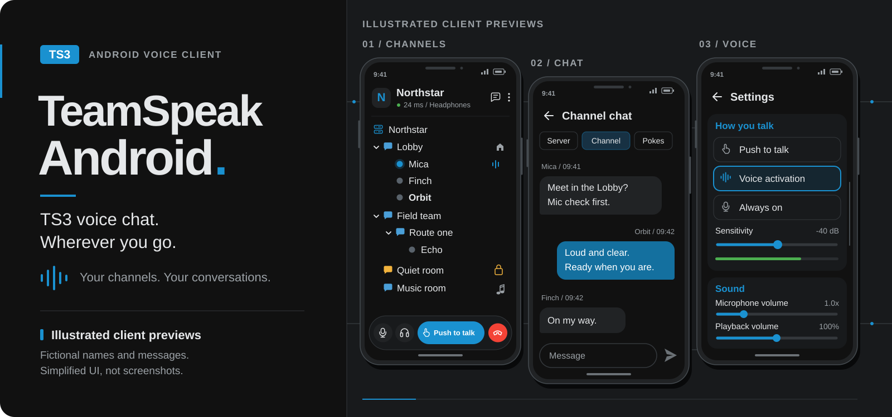
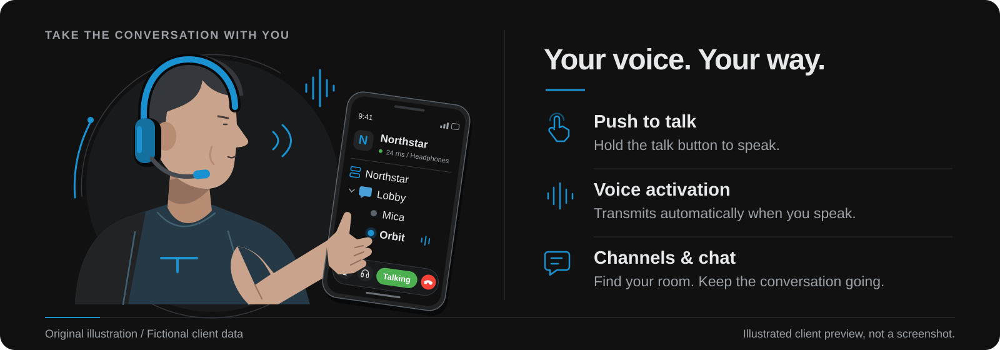

# TeamSpeak Android (TS3)

TS3 on your phone, with your channels, chats and voice controls in one place.

An unofficial Android client for **TeamSpeak 3**. Add your server, pick a channel and hang out, whether you're gaming, catching up with friends or just listening in.

[Download the latest APK](https://github.com/NotMurPh/teamspeak-android-ts3/releases/latest) | [Report a problem](https://github.com/NotMurPh/teamspeak-android-ts3/issues)

## What Is This?

A familiar TS3-style client made for Android, with a dark interface and the things you actually need close at hand: the server tree, who's talking, your messages and your microphone controls.

This is an independent project, **not the official TeamSpeak Android app**, and it isn't affiliated with or endorsed by TeamSpeak. The original client APK and official native client library are not included in this repository or used to build its releases.

## Features

- Join TS3 servers and browse channels and connected users.
- Push to talk, voice activation or an always-open microphone.
- Optional volume-key and headphone-button talk controls.
- Server, channel and private text chat, plus pokes.
- Saved servers, folders and multiple identities.
- Microphone testing, noise suppression, echo cancellation and automatic gain control.
- Phone, wired-headset and Bluetooth audio options.
- Channel files and server-management controls, where your permissions allow them.
- Spoken event announcements, notification sounds and reconnect options.
- Local backup and restore for your settings, identities and bookmarks.

## Preview

The phone views in these graphics are **illustrated previews, not screenshots**. Names, channels and conversations are fictional. The actual interface can change as the project develops.

## Installation

You'll need **Android 8.0 or newer** and a **64-bit ARM device (`arm64-v8a`)**. Older 32-bit phones and x86 devices aren't included in the current downloads.

1. Open the [latest release](https://github.com/NotMurPh/teamspeak-android-ts3/releases/latest).
2. Download `teamspeak-android-arm64-v8a.apk`.
3. Open the APK and, if Android asks, allow installation from the browser or file manager you're using.
4. Start **TS Client**, review its microphone, notification and Bluetooth permission requests, and tap **+** to add your server. Microphone access is needed to talk.

Your usual server rules, passwords and permissions still apply. This app doesn't give you a server or bypass its access restrictions.

**Already using a development build?** Export a backup from Settings **before uninstalling it**. GitHub releases use a new signing key, so an older debug-signed build needs one reinstall. Import your backup afterward. Later releases can install over earlier GitHub releases without that extra step.

## A Few Things To Know

- This is a work in progress. Keep a private backup of identities and settings you care about.
- Bluetooth behavior depends on your phone and headset. Classic Bluetooth normally switches playback to call quality when its microphone is used; using the phone microphone can keep higher-quality media playback.
- Backups contain private identities and saved passwords. Don't upload them to GitHub, an issue or a public chat.
- New successful pushes to `main` publish an APK release automatically. **In-app automatic updating isn't implemented yet.**

## Found A Problem?

[Open an issue](https://github.com/NotMurPh/teamspeak-android-ts3/issues) with your Android version, device/headset, app version and what happened. A short set of steps to reproduce it helps a lot.

Remove server addresses, passwords, tokens, identities and other people's information from logs or screenshots before sharing them.

## Credits And License

Original project code is licensed under [MIT](LICENSE). Third-party code, fonts, artwork and sounds keep their own licenses and ownership; see [Third-Party Components](THIRD_PARTY.md). TeamSpeak names, logos and sounds are not covered by the project's MIT license, and their public-redistribution permission has not been verified.

Release/build details live in [Release Maintenance](docs/RELEASING.md), rather than turning this page into a wall of build instructions.

Thanks for visiting. If you find it useful, a star is always appreciated!
